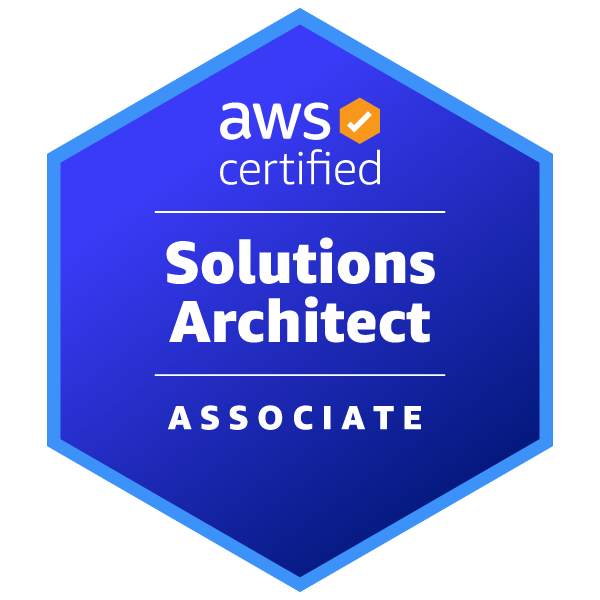
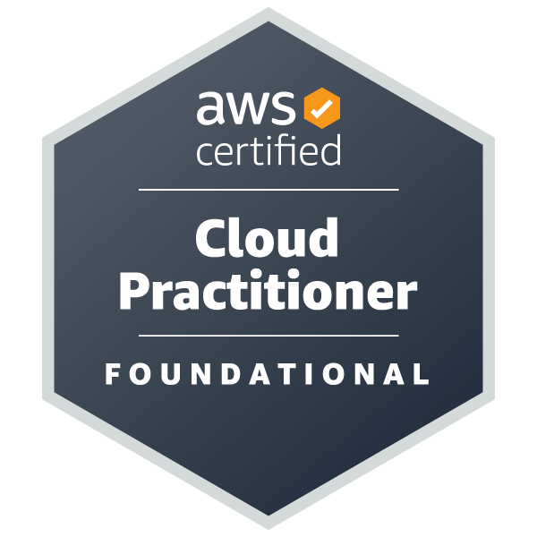

  # Hi there, I'm Mohammed MAJIDI 👋
  ### State Software Engineer & Cloud Solutions Architect
  
  

    <b>ENSA Khouribga</b> • <b>AWS Certified Solutions Architect – Associate</b>
  

  

    
    
    
    
  

   

  

---

## 🏆 Verified AWS Certifications

  <table>
    <tr>
      <td align="center" width="50%">
        
         
        <a href="https://www.credly.com/badges/b96f9967-fff6-416f-ad25-89806bd90c0e/public_url" target="_blank">
          
AWS Certified Solutions Architect – Associate

        </a>
         
        Validation: SAA-C03 • Click badge to verify on Credly
      </td>
      <td align="center" width="50%">
        
         
        <a href="https://www.credly.com/badges/2b203ec5-b8d4-48f1-80ce-0fa2aefe6804/public_url" target="_blank">
          <b>AWS Certified Cloud Practitioner</b>
        </a>
         
        Validation: CLF-C02 • Click badge to verify on Credly
      </td>
    </tr>
    <tr>
      <td align="center" colspan="2">
        
      </td>
    </tr>
  </table>

---

## 👨‍💻 Professional Summary

State Software Engineer graduated from **ENSA Khouribga** with dual expertise in **high-performance backend engineering** and **cloud-native architecture**:

- ☁️ **Cloud Architecture (AWS)**: Designing resilient, highly-available (99.9%), fault-tolerant distributed workloads on AWS (Lambda, RDS, S3, Cognito, SNS, VPC).
- ⚙️ **Distributed Microservices**: Production-level services in **Java 21 / Spring Boot & Spring Cloud**, event-driven messaging with **Apache Kafka**, and centralized OAuth2/OIDC security with **Keycloak**.
- 📐 **System Modeling & Business Analysis**: Bridging business domain needs and technical delivery through formal UML modeling, BPMN 2.0 process mapping, and UAT execution (**Capgemini TS**).
- ⚡ **Workflow & Web Automation**: RPA automation and data pipelines using **Playwright**, **Python**, and **Power Automate**, drastically reducing operational cycles.

---

## 🏗️ Technical Domain & Stack

<table>
  <tr>
    <td valign="top" width="50%">
      <h3>☁️ Cloud & Distributed Systems</h3>
      <ul>
        <li><b>Cloud Provider:</b> AWS (Lambda, RDS PostgreSQL/MySQL, S3, Cognito, SNS, VPC)</li>
        <li><b>Microservices:</b> Java 21, Spring Boot 3, Spring Cloud, Eureka, Spring WebFlux</li>
        <li><b>Messaging & Async:</b> Apache Kafka, AWS SNS</li>
        <li><b>Security & IAM:</b> Keycloak (OAuth2, OIDC), AWS Cognito</li>
        <li><b>DevOps & CI/CD:</b> Docker, Docker Compose, Jenkins, SonarQube</li>
      </ul>
      

        
        
        
        
        
      

    </td>
    <td valign="top" width="50%">
      <h3>💻 Full-Stack & Engineering Methods</h3>
      <ul>
        <li><b>Web & Frontend:</b> Next.js 16 (App Router), React 19, TypeScript, Tailwind CSS</li>
        <li><b>Languages & Backends:</b> Node.js, Python (FastAPI, Flask, scikit-learn)</li>
        <li><b>Databases & Search:</b> PostgreSQL, MySQL, Elasticsearch</li>
        <li><b>Process & Architecture:</b> BPMN 2.0 (Draw.io), UML (Use Case, Sequence), Agile/Scrum</li>
        <li><b>Automation & Quality:</b> Playwright RPA, Power Automate, UAT Defect Qualification</li>
      </ul>
      

        
        
        
        
        
      

    </td>
  </tr>
</table>

---

## 📊 GitHub Metrics

  
  

  

---

  <b>Let's connect & collaborate!</b> 
  <a href="https://linkedin.com/in/mohammed-majidi"><b>LinkedIn</b></a> • 
  <a href="mailto:Mohammedmajidi321@gmail.com"><b>Email</b></a> • 
  <a href="https://www.credly.com/badges/b96f9967-fff6-416f-ad25-89806bd90c0e/public_url"><b>Credly Profile</b></a>

